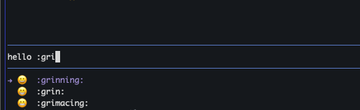

# pi-emoji-complete

Slack / Claude-style `:shortcode:` emoji autocomplete for the [Pi](https://pi.dev) editor.



## Features

- Triggers on `:<query>` (2+ characters) at the start of a line or after whitespace / opening punctuation
- Full GitHub emoji shortcode set (~1,900 emojis, extracted from `gemoji` with zero runtime dependencies)
- Live filtering as you type or backspace (exact → prefix → substring → fuzzy)
- Navigate with Up/Down arrows, accept with `Tab` or `Enter`, cancel with `Esc`
- Plays nicely with built-in `/` slash commands and `@` file path completion

## Install

```bash
pi install npm:pi-emoji-complete
```

Or try it for a single session:

```bash
pi -e npm:pi-emoji-complete
```

## Contributing

See [contrib.md](./contrib.md) for architecture notes, build-time emoji extraction, and testing instructions.
